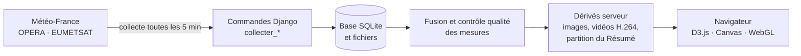

# HKO Météo

**La météo de la France, mise en scène comme un bulletin télévisé, à partir des données publiques.**

🌍 **En ligne : [hashkao.com/meteo](https://hashkao.com/meteo/)**

HKO Météo est un site d'observation météo entièrement automatisé. Toutes les cinq minutes, un serveur
collecte les mesures de Météo-France, le radar de précipitations européen et les images satellite
d'EUMETSAT, puis les transforme en cartes animées. Chaque nuit, la journée écoulée devient un court
film, le « Résumé du jour », fabriqué sans intervention humaine.

Le projet réunit mes deux métiers : le motion design pour la télévision et l'analyse de données.

<!--
  Ajouter ici une capture ou une courte animation du site, par exemple :
  
  (déposer le fichier dans docs/captures/ avant de décommenter la ligne)
-->

---

## Ce que l'on voit sur le site

| Rubrique | Ce qu'elle montre |
|---|---|
| **Satellite** | Le film de la journée, image après image : les nuages le jour, les lumières des villes la nuit. |
| **Températures** | Les relevés des stations sur une carte en relief, dans l'esprit des bulletins télévisés. |
| **Précipitations** | Le radar européen OPERA animé au-dessus de l'Europe. |
| **Conditions météo** | Soleil, nuages, pluie, neige, vent : une carte en pictogrammes, ville par ville. |
| **Résumé du jour** | Pour chaque journée passée, un film de 40 secondes : titre, températures, précipitations, synthèse. |
| **Est-ce normal ?** | La température du jour à Paris-Montsouris comparée au même jour de chaque année depuis 1900 : verdict, classement, records. |

Pour voir le Résumé du jour, il suffit de cliquer sur la flèche à gauche de la date pour revenir à la
veille.

## Les données

| Source | Données | Fréquence |
|---|---|---|
| Météo-France | Observations des stations (températures, vent, humidité, précipitations) | 6 min |
| Météo-France | Modèle AROME, pour compléter les zones sans station | plusieurs fois par jour |
| EUMETNET OPERA | Mosaïque radar européenne (format ODIM_H5) | 15 min |
| EUMETSAT | Images du satellite Meteosat (via EUMDAC) | plusieurs fois par heure |
| Météo-France | Relevés quotidiens historiques de Paris-Montsouris depuis 1900 | quotidienne |
| Copernicus | Relief de la France et de l'Europe | fixe |

## Comment ça marche



- **Collecte automatique** : des tâches `systemd` lancent les commandes de collecte et de calcul à
  intervalles réguliers, avec des verrous et des plafonds mémoire pour cohabiter avec les autres
  applications du serveur.
- **Contrôle qualité** : les mesures aberrantes sont écartées, par comparaison avec les stations
  voisines ramenées à la même altitude.
- **Satellite en vidéo** : plutôt que de faire charger des centaines d'images au navigateur, chaque
  journée satellite est encodée en vidéo H.264, en trois qualités selon l'écran. Le site reste fluide,
  même sur téléphone.
- **Résumé du jour** : chaque nuit, un programme Python condense les mesures de la journée dans un
  fichier léger, choisit un titre (« Grand soleil », « Pluie et vent », « Neige »…) et écrit le
  scénario. Le film est ensuite dessiné en direct dans le navigateur, sur un gabarit conçu comme un
  habillage télévisé (storyboard, charte, rythme).
- **Est-ce normal ?** : la mesure du jour est replacée dans la série de Paris-Montsouris. Le verdict
  repose sur la part des années plus froides ou plus chaudes, et la comparaison porte aussi sur la
  normale 1991–2020.

## Technologies

- **Serveur** : Python, Django, Gunicorn, Nginx, `systemd`, sur un VPS Scaleway
- **Données** : NumPy, SciPy, h5py, pyproj, Pillow, EUMDAC
- **Vidéo** : FFmpeg (H.264)
- **Navigateur** : JavaScript, D3.js, SVG, Canvas 2D, WebGL

## Organisation du dépôt

```
meteo_app/
├── management/commands/   collecte, fusion, dérivés, purge
├── sources/               lecture des sources (AROME, OPERA, satellite) et grilles
├── static/meteo_app/      JavaScript, CSS, géographie
├── templates/meteo_app/   pages du site
└── deploiement/           services systemd, configuration Nginx, notes de déploiement
crypto_vibe/               autre application du dépôt : analyse de sentiment sur les cryptomonnaies
```

## Lancer le projet en local

```bash
git clone https://github.com/BANAIAS/hashkao.git
cd hashkao
python -m venv .venv
source .venv/bin/activate          # Windows : .venv\Scripts\activate
pip install -r requirements.txt
pip install -r meteo_app/requirements-collecte.txt
python manage.py migrate
python manage.py runserver
```

Les clés d'accès aux API (Météo-France, EUMETSAT) se placent dans un fichier `.env`, qui n'est pas
versionné.

## Auteur

**Patrice Banaïas** — motion designer et data analyst

- Démo motion design : [vimeo.com/patricebanaias](https://vimeo.com/1010203947)
- Typographie 3D animée : [toumblak.com](https://toumblak.com)

Le développement a été réalisé avec l'aide d'outils d'intelligence artificielle. La conception
graphique, l'architecture, les choix techniques et la mise en production sont les miens.

*Données : Météo-France, EUMETNET OPERA, EUMETSAT, Copernicus. Ce site n'est pas un service officiel de
prévision.*
